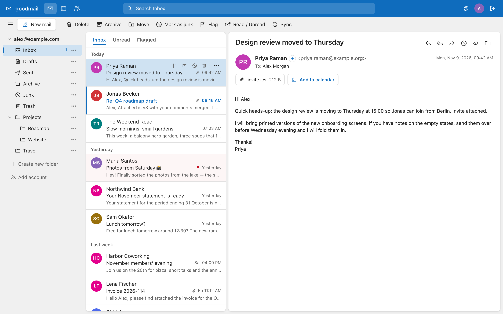
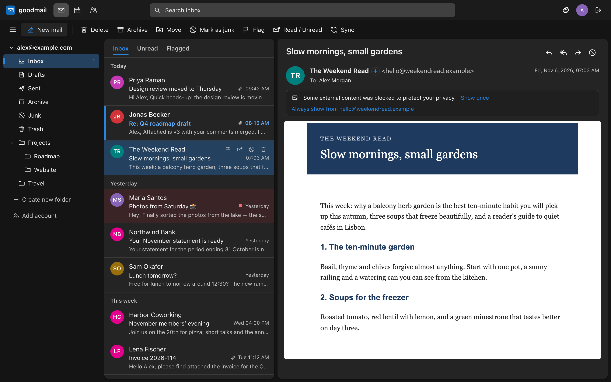
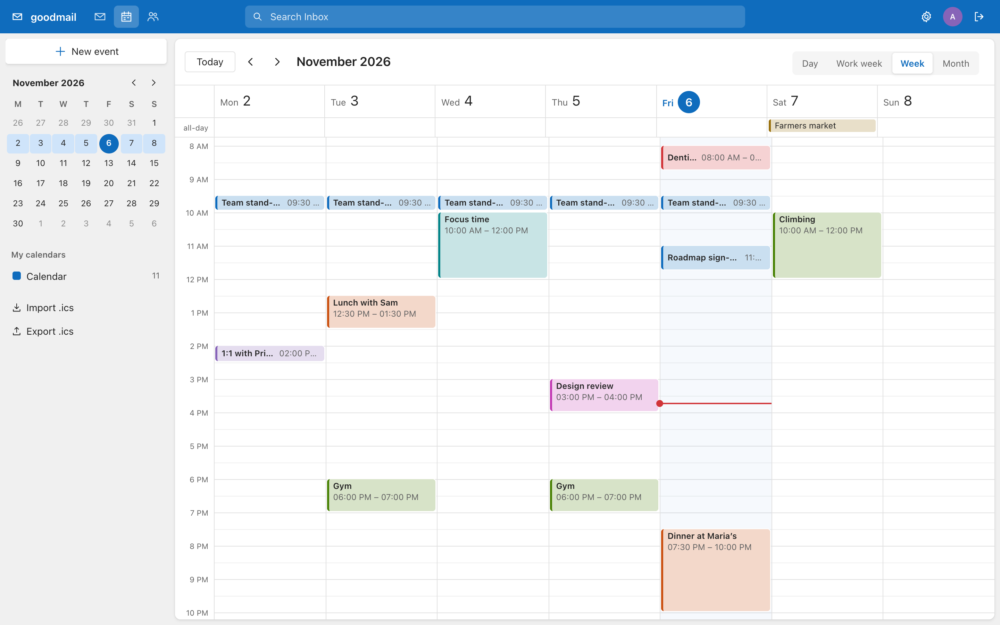
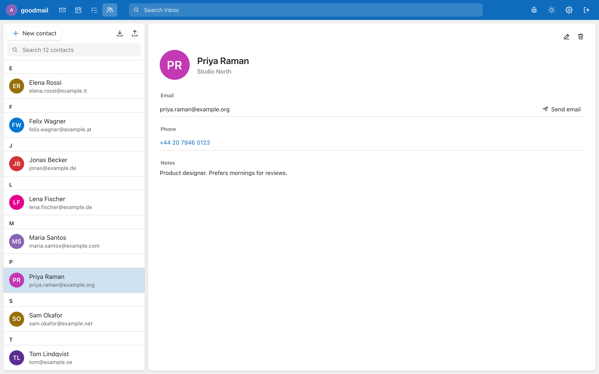
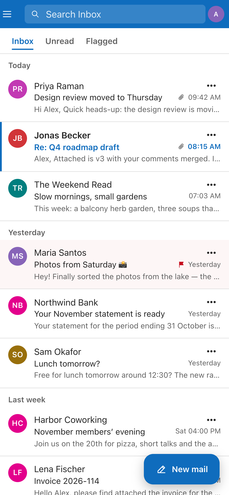
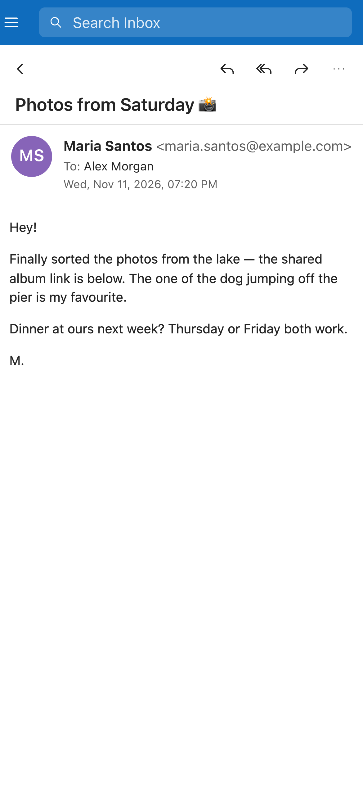

# goodmail

A webmail client that talks plain IMAP + SMTP to **any** mail server, with an Outlook-style
three-pane UI: folder tree, date-grouped message list with previews, reading pane, inline composer.



| Dark mode, remote images blocked | Calendar — week view |
|---|---|
|  |  |
| **Address book** | **On a phone** |
|  |   |

<sub>Screenshots use invented demo data — see [scripts/screenshots](scripts/screenshots).</sub>

- Sign in with just an e-mail address and password — a config file maps the domain to its servers
- "Keep me signed in" for a year (sealed cookie; nothing stored server-side but a key)
- Folder tree with unread counts, drag-and-drop to folders, create folders
- Message list grouped Today / Yesterday / This week…, preview lines, unread/flag/attachment markers,
  hover actions, Ctrl/Shift multi-select, infinite scroll, All / Unread / Flagged filters
- Server-side search (subject, from, to, body)
- Reading pane renders HTML mail sanitized (DOMPurify) in a script-less sandboxed iframe with its own CSP;
  **remote images and trackers are blocked** until you allow them once or per sender
- Reply, reply all, forward with quoted original; rich-text composer, attachments (button or drag-drop),
  sent mail saved to Sent; Delete → Trash, Archive, Mark as junk / Not junk (toolbar, hover button, message header or `!`), Move
- Keyboard: `j`/`k` move · `r` reply · `a` reply all · `f` forward · `e` archive · `Del` delete ·
  `u` read/unread · `!` junk / not junk · `n` new · `/` search · `⌘/Ctrl+Enter` send
- **Your own extra accounts**: each user can add iCloud, Gmail, Yahoo, GMX, WEB.DE, Fastmail or any IMAP
  mailbox (app passwords); one folder tree per account and a From picker. Passwords are stored encrypted with a
  key derived from the server key *and* the user's login password. User-entered servers must be public hosts on
  standard mail ports (no access to the server's private network).
- **Address book**: per-account contacts, vCard + CSV import/export (Apple, Google, Outlook, Thunderbird),
  duplicate merge by email, "add sender" button, To/Cc autocomplete
- **Calendar**: Outlook-style day / work week / week / month views, mini month, recurring events,
  .ics import/export, and an "Add to calendar" button on invitations (Outlook/Teams time zones understood)
- **Two-step sign-in** (per user, ⚙ → Sign-in security): authenticator app (TOTP), passkeys (Face ID / Touch ID /
  Windows Hello / security keys), a code mailed to a backup address (sent through the user's own mailbox), and
  one-time recovery codes. The login cookie is issued only after the second step. Passkeys can also sign in
  **without a password** (per passkey, on by default): the server then keeps an encrypted copy of the mail password
  for that passkey, refreshed on the next password sign-in after a password change. Passkeys need the site's real
  host name — behind a proxy keep `Host` (`ProxyPreserveHost On`) or set `GOODMAIL_ORIGIN=https://mail.example.com`
- **Mail rules** (⚙ → Mail rules, needs `sieveN=`): "when a message arrives and all/any of these match → move to a folder,
  mark read, flag, forward a copy, delete, stop". Rules are compiled to a Sieve script and stored on the mail server over
  ManageSieve, so they also run while you are signed out. A script written elsewhere is never overwritten without asking
- **Change password** (⚙ → Sign-in security, needs `passwordcmdN=`): current + new password; the mail server side is a
  command you provide, see "Changing passwords" below
- **Forgot password** (needs `passwordcmdN=` plus `resetfrom=`/`resetsmtp=`): each user saves a **second address**
  outside their own mailbox (⚙ → Sign-in security → Password reset address, confirmed with a code). From the sign-in
  page, "Forgot your password?" mails a one-time code to that address, then the user picks a new password. The page
  answers the same for unknown addresses, codes last 15 minutes with 5 tries, requests are rate-limited, and the mailbox
  itself gets a notice afterwards. Two-step sign-in still applies after a reset
- **Spam meter** under the date: green → yellow → red from the filter's score (rspamd or SpamAssassin headers;
  only the topmost header is trusted). Fully red at the junk threshold — rspamd 6 by default, `spamthreshold=` to change
- **Fast on slow servers**: opened messages are cached server-side (`GOODMAIL_CACHE_MB`, default 150), folder lists
  show instantly from the last visit and refresh behind, and the next messages are prefetched without marking them read
- **Languages**: English, Dansk, Deutsch, Svenska, Norsk, Français, Español — picked from the browser,
  switchable on the sign-in page and under ⚙. Dates and weekdays follow the language. Adding a language is one
  file in `web/src/locales/` (English text is the key, so anything untranslated falls back to English).
- Light / dark / auto theme with 8 accent colors (blue, teal, green, purple, pink, red, orange, graphite), reading pane right / below / hidden, works down to phone width

## Run

```bash
npm install
cp goodmail.conf.example goodmail.conf   # edit domains
npm run dev        # API on :3000 + Vite on :5173 (needs Node ≥ 23.6, runs the TS server directly)
npm test           # unit tests (vault, 2FA, config, contacts, calendar, i18n, utils) + a live-server smoke test
npm run typecheck  # tsc over server, web and tests
```

Production:

```bash
npm run build      # dist/ (web) + dist-server/index.mjs (single-file server bundle, Node ≥ 20)
NODE_ENV=production PORT=3000 node dist-server/index.mjs
```

Put it behind a TLS reverse proxy (the login cookie is `Secure` in production).
`deploy/goodmail.service` is an example systemd unit.

## Configuration — `goodmail.conf`

```ini
domain1=example.com
imap1=mail.example.com            # host[:port], default 993 (TLS); 143 = STARTTLS
smtp1=mail.example.com:587        # default: imap host, 465 (TLS); 587 = STARTTLS

domain2=*                        # catch-all for any other domain
imap2=mail.example.net
ca2=/etc/goodmail/ca.pem         # optional extra CA bundle
ciphers2=HIGH:!DHE               # optional OpenSSL cipher list
login2=local                     # send "user" instead of "user@domain" as the IMAP/SMTP username
insecure2=true                   # accept self-signed certificates
title2=Example Mail              # app name these users see after signing in
title2.de=Beispiel-Mail          # the same name in German (see "Localized app name" below)

sieve2=mail.example.net          # ManageSieve host[:port], default 4190 (STARTTLS) → turns on "Mail rules"
passwordcmd2=ssh -i /etc/goodmail/pw-key pw@mail.example.net   # → turns on "Change password" (see below)
passwordmin2=12                  # shortest accepted new password (default 10; passwordmin= for all domains)

defaultdomain=example.com       # "bo" logs in as bo@example.com
autodiscover=false               # true: guess servers for unlisted domains (autoconfig / ISPDB / MX)
title=goodmail                   # sign-in page, and domains without their own titleN
title.da=Min mail                # optional per-language variants of the global title
title.fr=Ma messagerie
```

The file is re-read automatically when it changes.

**Localized app name.** `title` and `titleN` can be given per language with a `.<code>` suffix, using the codes of
the language picker (`da`, `de`, `en`, `es`, `fr`, `nb`, `sv`). The sign-in page and the browser tab/header show the
variant that matches the visitor's chosen (or browser) language, and fall back to the plain `title` when there is none.
A domain that has its own `titleN` uses only its own `titleN.<code>` lines; domains without one use the global `title.<code>` lines.

**Mail rules** need a ManageSieve service (Dovecot Pigeonhole: `protocols = … sieve`, port 4190, STARTTLS). goodmail
signs in with the user's own mailbox password, keeps its rules in a script called `goodmail` (the editable model is stored
in a comment on the script's first line) and activates it. If the mailbox already has an active script that goodmail did
not write, the editor says so and replaces it only after the user ticks "Replace the existing filter" — a copy is kept as
`goodmail-previous`. Folder names are used exactly as the IMAP server lists them.

**Changing passwords.** Mail servers store passwords in very different places, so goodmail does not guess: it runs the
command from `passwordcmdN` (split into arguments, never through a shell) and writes one JSON line to its stdin:
`{"login":"user@example.com","user":"<imap username>","old":"…","new":"…"}`. Exit status 0 means the password is now
changed; any other status is a failure, and the first line the command printed on stdout (if any) is shown to the user
(`Password is too weak`) — stderr is only logged. The user's current password was already checked against the session,
and the new one is checked for length (`passwordmin`) and control characters. Afterwards goodmail confirms that the new
password opens the mailbox, re-encrypts the user's saved extra accounts and passwordless passkeys under it, and signs the
browser in again; other devices have to sign in again. A typical command is `ssh` to the mail server with a key that is
locked to one forced command, which hashes the password and updates the user database. `ops/goodmail-setpw` is such a
helper for Postfix + Dovecot + PostfixAdmin (BLF-CRYPT into the `mailbox` table): install it as root on the mail server, add
`command="sudo -n /usr/local/sbin/goodmail-setpw",from="<web server IP>",no-pty,no-port-forwarding <public key>` to the
forced-command user's `authorized_keys`, and allow just that script in sudoers.

**Forgot password.** Nobody is signed in then, so the code can't go out through the user's own mailbox: `resetfrom=` is
a dedicated sender address, `resetsmtp=host[:port]` its server (465 = TLS, 587 = STARTTLS), with `resetuser=`/`resetpass=`
as its login (`resetinsecure=true` accepts a self-signed certificate). The reset itself runs the same `passwordcmdN`
command as a normal change, with `"reset": true` and an empty `"old"` in the JSON. A reset also leaves the user's saved
extra accounts locked until they enter their previous password once, and passwordless passkeys work again after the next
password sign-in.

| Environment | Default | |
|---|---|---|
| `PORT` / `HOST` | `3000` / `0.0.0.0` | listen address |
| `GOODMAIL_CONFIG` | `./goodmail.conf` | config file |
| `GOODMAIL_DATA` | `./data` | `secret.key` (cookie encryption key), `accounts/`, `contacts/`, `calendar/`, `mfa/` (one JSON file per account) |
| `GOODMAIL_SECRET` | — | use this instead of `secret.key` |
| `GOODMAIL_SOURCE_URL` | this repo | where the in-app "Source code" link points (AGPL §13 — set it for modified versions) |
| `GOODMAIL_CACHE_MB` | `150` | memory for cached parsed messages |
| `GOODMAIL_TRUST_PROXY` | `false` | trust `X-Forwarded-For` (set behind a proxy) |

## Security model

- The login cookie contains the credentials encrypted with AES-256-GCM under the server key, so sessions
  survive restarts without a database. Deleting `secret.key` signs everyone out.
- Open IMAP connections live in memory per session and are closed after 10 minutes idle.
- Mutating API calls require a custom header (CSRF), cookies are `HttpOnly; SameSite=Strict`.
- Login attempts are rate-limited per IP.

## License

Copyright (C) 2026 Anton Popov

goodmail is free software: you can redistribute it and/or modify it under the terms of the
**GNU Affero General Public License v3.0 or later** (AGPL-3.0-or-later) — see [LICENSE](LICENSE).

In short: you may use, self-host, modify and share it. If you run a **modified** version for other people
over a network, you must offer those users the source code of your version. goodmail shows a
"Source code" link for this; point it at your fork with `GOODMAIL_SOURCE_URL`.

Third-party dependencies keep their own (permissive: MIT, BSD, ISC, Apache-2.0/MPL-2.0) licenses.
